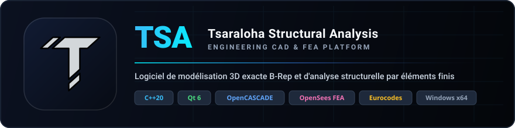

<p align="center">
  
</p>

<p align="center">
  
</p>

<h1 align="center">TSA — Tsaraloha Structural Analysis</h1>

<p align="center">
  <strong>Plateforme logicielle de modélisation CAO 3D B-Rep exacte et d'analyse structurelle par éléments finis (FEA) pour le génie civil.</strong><br>
  Développé en <b>C++20</b> avec <b>Qt 6</b>, le noyau géométrique <b>OpenCASCADE (OCCT)</b> et le moteur de calcul <b>OpenSees</b>.
</p>

<p align="center">
  <a href="https://en.cppreference.com/w/cpp/20"></a>
  <a href="https://www.qt.io/"></a>
  <a href="https://dev.opencascade.org/"></a>
  <a href="https://opensees.berkeley.edu/"></a>
  <a href="https://www.microsoft.com/windows"></a>
  <a href="https://cmake.org"></a>
  <a href="docs/TESTING.md"></a>
  <a href="docs/NORMATIVE_SYSTEM.md"></a>
</p>

<p align="center">
  <a href="#-getting-started--démarrage-rapide">Démarrage Rapide</a> •
  <a href="#3-compilation">Compilation</a> •
  <a href="#-fonctionnalités-majeures">Fonctionnalités</a> •
  <a href="#-ruban-principal--ergonomie-cao">Interface</a> •
  <a href="#-architecture-logicielle--source-de-vérité">Architecture</a> •
  <a href="#-tests-automatisés">Tests</a> •
  <a href="#-système-dextensions-tsalib">TSALib</a> •
  <a href="#-documentation-technique">Documentation</a>
</p>

---

## 📖 Présentation

**TSA (Tsaraloha Structural Analysis)** est une suite logicielle desktop d'ingénierie des structures de nouvelle génération. Elle fusionne la fidélité géométrique volumique B-Rep d'un modeleur CAO industriel (**OpenCASCADE Technology**) avec un moteur de calcul aux éléments finis de référence (**OpenSees**), le tout orchestré par une interface utilisateur réactive et moderne (**Qt 6**) organisée autour d'un Ruban ergonomique à 8 onglets et de fenêtres ancrables intelligentes.

TSA permet de concevoir, modéliser, charger, analyser et inspecter en 3D interactive des bâtiments à étages, des halles industrielles, des fermes et treillis spatiaux, des structures haubanées et des systèmes de fondations selon les normes européennes (**Eurocodes**).

> **Écosystème Tsaraloha.** TSA partage ses bibliothèques (`src/`) avec **TSALab**, le laboratoire scientifique
> ([dépôt TSALab](https://github.com/ChristinotLeonnel/Tsaraloha-Structural-Analysis-Virtual-Laboratory)), dont TSA
> compile en retour le cœur scientifique (`TSALab/science`, solveur des ossatures planes). Les deux dépôts se placent
> côte à côte ; voir [docs/TSARALOHA_ARCHITECTURE.md](docs/TSARALOHA_ARCHITECTURE.md).

---

## 🚀 Getting Started / Démarrage Rapide

### Prérequis

À installer soi-même (le script de la section 2 installe tout le reste) :

| Outil | Version | Remarque |
| :--- | :--- | :--- |
| Windows | 10 / 11, x64 | Linux : voir [docs/LINUX_BUILD.md](docs/LINUX_BUILD.md) (Ubuntu 24.04, GCC 13) |
| Visual Studio | 2026 (ou 2022), x64 | charge « Développement Desktop en C++ » (MSVC, Windows SDK, Ninja). **MinGW n'est pas pris en charge** : Qt et OpenCASCADE sont des builds MSVC. |
| CMake | ≥ 3.20 | |
| Git | — | clonage des dépôts TSA et TSALab |
| Python | ≥ 3.8 | sous Windows, lancer `py -3` (la commande `python` peut ouvrir le Microsoft Store) |

---

### 1. Cloner les dépôts

TSA compile le cœur scientifique de TSALab : les deux dépôts doivent être **côte à côte**. Les noms courts (`TSA`,
`TSALab`) comme les noms GitHub (`Tsaraloha-Structural-Analysis`, `Tsaraloha-Structural-Analysis-Virtual-Laboratory`)
sont reconnus.

```powershell
git clone https://github.com/ChristinotLeonnel/Tsaraloha-Structural-Analysis.git TSA
git clone https://github.com/ChristinotLeonnel/Tsaraloha-Structural-Analysis-Virtual-Laboratory.git TSALab
cd TSA
```

Si TSALab n'est pas cloné, le script de la section 2 le clone dans `../TSALab`. Autre emplacement :
`-DTSALAB_ROOT_DIR=<chemin>` à CMake.

---

### 2. Installer les dépendances et configurer

Un seul fichier, [`install_dependencies.py`](install_dependencies.py), met tout en place puis configure CMake :

```powershell
py -3 install_dependencies.py --configure
```

| Dépendance | Version | Emplacement | Statut |
| :--- | :--- | :--- | :--- |
| TSALab (cœur scientifique) | dépôt voisin | `../TSALab` | obligatoire |
| Qt | 6.12.0 (`msvc2022_64`) | `thirdparty/Qt`, ou une installation existante (`C:\Qt\6.*`) | obligatoire |
| OpenCASCADE + 3rdparty | 8.0.1 (`vc14-64`) | `thirdparty/` | obligatoire |
| OpenSees | 3.8.0 (conda-forge) | `thirdparty/OpenSees` | facultatif (moteur par défaut) |
| Gmsh | 4.15.2 | `thirdparty/` | facultatif (maillage) |
| Eigen | 3.4.1 | `thirdparty/` | facultatif (moteur Fem3D) |
| IfcOpenShell | 0.9.0post1 | `thirdparty/` | facultatif (import IFC, compilé : environ une heure) |

- Toute archive est vérifiée par SHA-256 avant extraction (manifeste [`cmake/dependencies.json`](cmake/dependencies.json)) ;
  ce qui est déjà présent n'est pas réinstallé, et un téléchargement interrompu reprend au lancement suivant.
- `--configure` lance `cmake --preset ninja-debug` dans l'environnement de Visual Studio (`vcvars64.bat`, trouvé
  automatiquement) : inutile d'ouvrir l'invite « x64 Native Tools ».

```powershell
py -3 install_dependencies.py --list                                         # état, rien n'est modifié
py -3 install_dependencies.py --configure ninja-release --skip ifcopenshell  # autre preset, sans IfcOpenShell
py -3 install_dependencies.py --only qt,occt --force qt                      # composants choisis, réinstallation
```

Détails (versions acceptées, détection, rapport `tsa-dependencies.txt`) : [docs/DEPENDENCIES.md](docs/DEPENDENCIES.md).

---

### 3. Compilation

#### Option A : Ninja *(recommandé)*

Les presets Ninja demandent l'environnement MSVC. Depuis PowerShell :

```powershell
$vcvars = "C:\Program Files\Microsoft Visual Studio\18\Community\VC\Auxiliary\Build\vcvars64.bat"
cmd /c "`"$vcvars`" >nul && cmake --build --preset ninja-debug -- -k 0 -j 4"
```

Ou, dans une invite « x64 Native Tools » :

```powershell
cmake --build --preset ninja-debug -- -k 0 -j 4      # Debug   -> build-ninja-debug
cmake --preset ninja-release                         # Release -> build-ninja-release
cmake --build --preset ninja-release -- -j 4
```

> `-j 4` : au-delà, MSVC peut manquer de mémoire virtuelle pour les en-têtes précompilés (erreur C3859).

#### Option B : Visual Studio

```powershell
cmake --preset windows-x64-release                   # -> build/
cmake --build --preset windows-x64-release
```

Ces presets n'ont pas besoin de l'environnement MSVC.

---

### 4. Lancement de TSA

```cmd
run.bat                      :: TSA.exe le plus récemment compilé
run.bat build-ninja-debug    :: TSA.exe d'un dossier de build précis
```

> `run.bat` retrouve Qt (cache CMake du dossier de build, sinon `C:\Qt\6.*\msvc*_64`), OpenCASCADE et ses 3rdparty,
> règle les variables OCCT (`CSF_OCCTResourcePath`, `CSF_OCCTShadersPath`) et le `PATH`, puis démarre `TSA.exe`.

---

## ⚡ Optimisation du Pipeline de Build

Le temps de compilation de TSA est optimisé pour les développeurs C++ exigeants :

* **Bibliothèques en couches compilées une seule fois :** `TSA_Core` (statique : QtCore et géométrie OCCT seulement), `TSA_Model`, `TSA_Graphics`, `TSA_Widgets`, puis l'application. Elles sont liées par `TSA.exe`, par la suite de tests `TSA_TestSuite.exe`, et compilées à l'identité de TSALab pour `TSALab.exe`. L'ordre des couches (model < graphics < widgets < app) est contrôlé par `tools/check_layers.py`.
* **En-têtes Précompilés (PCH) Partagés :** Les en-têtes volumineux stables (Qt Widgets/Core, OpenCASCADE `gp_*`/`TopoDS_Shape`, STL C++20) sont précompilés et réutilisés par les cibles.
* **Includes OpenCASCADE en `SYSTEM` :** Élimine le coût d'analyse des avertissements issus des bibliothèques externes.

---

## ✨ Fonctionnalités Majeures

### 1. 🏗️ Modélisation Structurale & Noyau CAO 3D B-Rep
* **Solides B-Rep Exacts (OpenCASCADE 8.0.1)** : Pas de facettisation polygonale approximative ; géométrie volumique exacte pour tous les profilés, nœuds et assemblages.
* **Éléments Filaires 1D** : Poutres, poteaux, barres spatiales génériques, câbles et haubans précontraints (barres articulées, calcul linéaire).
* **Générateur Automatique de Treillis** : Création instantanée et paramétrique de fermes métalliques de types **Warren** (diagonales alternées), **Pratt** (diagonales tendues) et **Howe** (diagonales comprimées).
* **Éléments Surfaciques 2D** : Dalles et planchers (report de charge unidirectionnel ou bidirectionnel), voiles et murs porteurs banchés, semelles superficielles de fondation.
* **Plans de Travail 3D Interactifs (WorkPlanes)** : Définition par 3 points arbitraires ou alignement sur les niveaux d'étages ; projection bidirectionnelle non-destructive 2D $\leftrightarrow$ 3D et magnétisme intelligent (extrémités, milieux, centres, grilles).
* **Conditions d'Appuis Spatiales (6 DDL)** : Encastrements complets, rotules/articulations, appuis simples (rouleaux), degrés de liberté découplés ($T_x, T_y, T_z, R_x, R_y, R_z$) représentés par de véritables solides B-Rep (plaques d'assise, cônes, cylindres).
* **Système d'Actions & Combinaisons Eurocodes** : Forces et moments nodaux, charges linéiques réparties uniformes et trapézoïdales, calcul automatique du poids propre volumique, cas de charges et combinaisons ELU / ELS.

### 2. 🧮 Moteurs de Calcul

> **TSA prend actuellement en charge l'analyse structurale linéaire. L'analyse non linéaire n'est pas disponible dans cette version.**

* **Analyses disponibles** :
  * Statique linéaire : $[K]\{u\} = \{F\}$, petits déplacements, matériaux élastiques linéaires, premier ordre.
  * Modale : fréquences, formes propres et masses participantes (OpenSees).
* **Non disponible** : analyse non linéaire (second ordre $P\text{-}\Delta$, grands déplacements, plasticité, pilotage
  incrémental), pushover et analyses temporelles. Un ancien projet qui demandait une analyse non linéaire s'ouvre
  normalement, mais son calcul est refusé avec un message tant qu'une analyse linéaire n'a pas été choisie (ADR-025).
* **Moteurs** (`AnalysisManager`, [docs/ANALYSIS_ENGINES.md](docs/ANALYSIS_ENGINES.md)) : OpenSees (par défaut, 3D,
  résolution en un seul pas par `algorithm Linear`), Fem3D (3D : poutres, rotules, appuis élastiques ; facultatif, compilé
  si le dépôt voisin `../3DDesplacement` est présent), Custom2D (ossatures planes, cœur scientifique de TSALab).
* **Câbles** : barres articulées précontraintes (déformation initiale $\varepsilon_0 = T_0 / EA$), calculées en un seul pas
  linéaire ; une compression n'est pas relâchée.
* **Vérifications réglementaires** : distinctes de l'analyse. Elles sont partielles et ne sont pas validées du seul fait que
  l'analyse est linéaire (voir la note de calcul, chapitre « Limites connues du logiciel »).

### 3. 📊 Visualisation 3D des Résultats & Inspection
* **Déformée 3D Amplifiée** : 3 modes d'affichage (Initial non déformé, Déformé seul, Superposition des deux) avec calibrage automatique sur l'envergure caractéristique du modèle ($L_{span}$).
* **4 Familles de Diagrammes 3D Orientés dans les Repères Locaux** :
  * **Moments de flexion & torsion :** $M_z$ (axe fort), $M_y$ (axe faible), $M_x$ (torsion).
  * **Efforts tranchants :** $V_z$ et $V_y$.
  * **Effort normal :** Traction et compression axiale $N$.
  * **Déplacements et rotations :** $U_x, U_y, U_z, U_{res}$, rotations nodales $R_x, R_y, R_z$.
* **Légende 3D Interactive en Surimpression** : Titre de l'effort, valeurs extrêmes (min/max), échelle effective et unités physiques du Système International ($kN, kNm, mm, rad$).
* **Réactions d'Appuis Vectorielles** : Flèches 3D proportionnelles avec affichage dynamique des valeurs aux nœuds d'appuis.
* **Détection Automatique des Nœuds Libres** : Signalement visuel proéminent des nœuds orphelins (sphères magenta) et filtrage contextuel (*Tous*, *Libres*, *Appuis*, *Sélectionnés*).
* **Modes propres** : curseur pour parcourir les formes propres d'une analyse modale.

### 4. 🖥️ Espace Multi-Vues (Multiport)
* Découpage dynamique de la fenêtre 3D : Vue unique, Double vue horizontale (2H), Double vue verticale (2V), Grille $2 \times 2$ (4 vues simultanées indépendantes), Vue ongletisée.
* Rendu graphique indépendant par port sans recalcul mécanique.

---

## 🎀 Ruban Principal & Ergonomie CAO

L'interface graphique est conçue autour d'un **Ruban moderne à 8 onglets contextuels** inspiré des standards CAO/BIM :

| Onglet | Panneaux & Outils Principaux |
| :--- | :--- |
| **1. Accueil** | **Projet** (Nouveau, Ouvrir, Enregistrer, Enregistrer sous), **Historique** (Annuler, Rétablir, Copier, Coller), **Accès Rapide** (Sélection, Poutre, Poteau, Dalle, Calcul Statique, Panneau Résultats 3D), **Vue 3D** (Vue 3D, Cadrer tout, Réinitialiser vue). |
| **2. Modélisation** | **Éléments Filaires (1D)** (Poutre, Poteau, Câble, Barre générique, Treillis automatique), **Éléments Surfaciques (2D)** (Dalle/Plancher, Voile/Mur, Semelle), **Nœuds & Primitives** (Placer Nœud, Cube), **Trame & Niveaux** (Créer Grille, Gestionnaire de Grilles, Gestionnaire d'Étages/Niveaux), **Préréglages**. |
| **3. Structure** | **Sections & Profilés** (Profilé I/H, Rectangulaire, Circulaire), **Matériaux** (Béton Armé EC2, Acier Structural EC3), **Conditions d'Appuis** (Encastrement, Articulation, Appui Simple), **Bibliothèques & TSALib** (Gestionnaire d'extensions TSALib, Catalogue de sections). |
| **4. Calcul** | **Actions & Charges** (Force Ponctuelle, Charge Répartie, Moment, Cas & Combinaisons), **Discrétisation** (Générer Maillage EF), **Solveur** (Calcul Statique, Paramètres de Calcul & Solveurs OpenSees). |
| **5. Résultats** | **Panneau** (Ouvrir le panneau Résultats 3D), **Déformée 3D** (Activer/Masquer déformée), **Diagrammes 3D** ($M_z, M_y, M_x$, $V_z, V_y, N$, Flèches $U_z/U_{res}$, Masquer), **Réactions** (Afficher réactions 3D), **Cadrage** (Cadrer Déformée, Cadrer Résultats, Cadrer Modèle, Cadrer Tout), **Note de Calcul** (Inspecteur NDC), **Espace Multi-Vues** (1 vue, 2H, 2V, 2x2, Onglets). |
| **6. Édition** | **Sélection** (Mode sélection, Tout sélectionner), **Déplacement** (Déplacement 3D, Translation relative), **Copie & Duplication** (Copie 3D, Rotation 3D), **Repère** (Déplacer l'origine), **Presse-papier** (Copier, Coller), **Suppression** (Supprimer éléments sélectionnés). |
| **7. Affichage** | **Projections** (Vue 3D, Dessus, Dessous, Face, Arrière, Gauche, Droite, Isométrique, Accueil), **Navigation** (Zoom étendu, Zoom sélection, Zoom fenêtre, Zoom +/-, Historique vue précédente/suivante), **Plans & Coupes** (Vue normale au plan, Plans XY, XZ, YZ, Plan d'étage, Plan personnalisé, Coupes 3D), **Aides Visuelles** (Grille, Niveaux, Règles, Nœuds, Étiquettes, Magnétisme grille/objets, Plein écran), **Fenêtres & Docks** (Arbre du Modèle, Propriétés, Résultats 3D, Visibilité, Console). |
| **8. Outils** | **Inspection** (Mesurer distance spatiale 3D), **Environnement** (Basculer thème Sombre / Clair), **Documentation** (Aide intégrée, Guide des raccourcis clavier, À propos de TSA). |

### Système de Panneaux Docks Centralisés (`WindowManager`)
L'espace de travail s'adapte à vos besoins grâce aux docks ancrables gérés de manière centralisée :
1. **Arbre du Modèle (`ModelTreeDock`)** : Hiérarchie complète des éléments (Nœuds, Poutres, Poteaux, Câbles, Dalles, Voiles, Niveaux, Grilles) avec synchronisation bidirectionnelle de sélection.
2. **Inspecteur des Propriétés (`PropertiesDock`)** : Édition contextuelle des sections, matériaux, cotes, excentrements, et volet d'inspection nodale des résultats OpenSees.
3. **Contrôle des Résultats 3D (`ResultsDockWidget`)** : Choix des sollicitations affichées, mode de déformée, slider temporel/incrémental, filtrage des nœuds et presets de cadrage.
4. **Calques & Visibilité (`VisibilityDock`)** : Masquage ou affichage fin des grilles, niveaux, cotes, repères et charges.
5. **Palette d'Éléments Structuraux (`StructuralElementsDock`)** : Accès direct pour le tracé interactif rapide.
6. **Plans de Travail & Caméra (`ProjectionViewDock`)** : Gestionnaire des plans de travail multiples et alignement caméra.
7. **Console de Diagnostics (`LogConsoleDock`)** : Suivi d'exécution en direct, sortie des solveurs et ligne de commande.

---

## 🏛️ Architecture Logicielle & Source de Vérité

TSA applique un principe architectural strict : **le modèle structural (`TSA::Model::Model`) est la source de vérité unique**.

```text
               +-------------------------------------------+
               |        Interface Utilisateur (Qt 6)       |
               |       Ribbon, Docks, Dialogs, Widgets     |
               +-------------------------------------------+
                                     |
                                     | Signaux / Commandes réversibles
                                     v
               +-------------------------------------------+
               |  Commands & Undo/Redo (ICommand, Manager) |
               |    Model Snapshots & Historique d'actions |
               +-------------------------------------------+
                                     |
                                     v
  =======================================================================
  ===   MODÈLE STRUCTURAL (TSA::Model::Model) — SOURCE DE VÉRITÉ      ===
  ===   Node, Beam, Column, Cable, Slab, Wall, Foundation, Section   ===
  =======================================================================
                   /                                   \
                  /                                     \
                 v                                       v
    +-------------------------+             +-------------------------+
    |  Constructeurs Géométrie |             |  Analyse (AnalysisMgr)  |
    |    (*Geometry OCCT)     |             | OpenSees|Fem3D|Custom2D |
    +-------------------------+             +-------------------------+
                 |                                       |
                 v                                       v
    +-------------------------+             +-------------------------+
    | Visualisation 3D (OCCT) |             |    Résultats de Calcul  |
    | AIS_Shape, OccView, V3d |             |   NVM, U, Déformée 3D   |
    +-------------------------+             +-------------------------+
```

* Aucun widget UI ne manipule directement la géométrie OpenCASCADE.
* Aucune forme OCCT (`TopoDS_Shape`) n'est utilisée pour stocker des données mécaniques.
* Les modifications d'état transitent par le système de commandes transactionnelles avec support complet Undo/Redo.

---

## 🧪 Tests Automatisés

Dernière validation complète (2026-11-01, Release) : **60 suites, 572 tests, 0 échec** ; banc de validation des
calculs 2 097 / 2 097 ; TSALab 27 / 27.

```powershell
# Compilation de la suite (cible TSA_Tests -> TSA_TestSuite.exe), environnement MSVC chargé
cmake --build --preset ninja-debug --target TSA_Tests

# Exécution recommandée : un processus et un délai par suite, dossier de sortie jetable (hors dépôt)
py -3 tools/ci/run_test_suites.py --exe build-ninja-debug/TSA_TestSuite.exe --out <dossier> `
   --available opensees,gmsh,display --timeout 600

# Une seule suite (diagnostic)
.\build-ninja-debug\TSA_TestSuite.exe --suite=io
```

> `TSA_TestSuite.exe` n'a aucun délai interne et écrit des fichiers dans le dossier courant : ne pas le lancer depuis la
> racine du dépôt. Une suite dont la dépendance manque (OpenSees, Gmsh, IfcOpenShell, affichage) est signalée
> NON EXÉCUTÉE, jamais comptée réussie. Catégories, suites OpenGL, risques de blocage : [docs/TESTING.md](docs/TESTING.md).

---

## 📦 Système d'Extensions TSALib

TSA est doté du système d'extensions dynamiques d'ingénierie **TSALib** (`TSA::ExtensionSystem`) :
* **100% Découplé du Binaire :** Matériaux Eurocodes, profilés métalliques européens (IPE, HEA, HEB, UPN), sections personnalisées, câbles et textures PBR sont stockés au format ouvert JSON/PNG et modifiables sans recompiler le logiciel.
* **Rechargement à Chaud (Hot Reload) :** Actualisation instantanée du modèle 3D et des bibliothèques en un clic.
* **Packaging Autonome (`.tsalib`) :** Importation et exportation d'archives compressées autonomes signées par somme de contrôle SHA-256 avec protection anti-Path-Traversal.
* **Reproductibilité des Calculs :** Snapshots mécaniques scellés dans le fichier de projet `.tsa` (`CHUNK_SNAP`).

> 📖 **Pour en savoir plus, consultez le guide dédié : [docs/TSALIB_SYSTEM.md](docs/TSALIB_SYSTEM.md).**

---

## 🎮 Navigation & Raccourcis 3D

Les interactions et raccourcis clavier respectent scrupuleusement la norme internationale de documentation technique **IEEE Std 1063-2001** :

| Action / Commande | Raccourci Clavier / Souris |
| :--- | :--- |
| **Rotation / Orbite 3D** | Clic droit maintenu + Déplacement souris |
| **Panoramique (Pan)** | Clic molette maintenu + Déplacement souris |
| **Zoom avant / arrière** | Molette de la souris |
| **Centrer la vue (Fit All)** | <kbd>F</kbd> |
| **Cadrer la sélection** | <kbd>Maj</kbd> + <kbd>F</kbd> |
| **Vue isométrique initiale** | <kbd>R</kbd> |
| **Vue d'accueil (Home)** | <kbd>Origine (Home)</kbd> |
| **Vue de dessus (Plan XY)** | Pavé numérique <kbd>7</kbd> |
| **Vue de face (Plan XZ)** | Pavé numérique <kbd>1</kbd> |
| **Vue de droite (Plan YZ)** | Pavé numérique <kbd>3</kbd> |
| **Inspecteur des Propriétés** | <kbd>P</kbd> |
| **Lancer le Calcul EF** | <kbd>F5</kbd> |
| **Générateur Note de Calcul** | <kbd>F8</kbd> |
| **Plein Écran** | <kbd>F11</kbd> |
| **Aide contextuelle** | <kbd>F1</kbd> |

---

## 📁 Organisation du Dépôt

```text
TSA/
├── cmake/                      # Modules CMake : produits (TSAProduct), dépendances, déploiement des DLL
│   └── dependencies.json       # Manifeste des dépendances (versions, adresses, SHA-256)
├── docs/                       # Guides d'architecture et spécifications techniques
│   ├── ARCHITECTURE.md         # Flux de données et principes de conception
│   ├── TSALIB_SYSTEM.md        # Spécification complète du système d'extensions TSALib
│   ├── TSA_FILE_FORMAT.md      # Spécification du format binaire .tsa (chunks)
│   ├── TSA_DIAGNOSTICS.md      # Journalisation, télémétrie et rapports de crash
│   ├── ANALYSIS_OPENSEES.md         # Intégration du solveur OpenSees et formulations EF
│   ├── OPENSEES_CALCULATION_METHODS.md # Méthodes de calcul et types d'analyse linéaires (guide utilisateur)
│   ├── OPENSEES_RESULTS.md         # Structure des résultats et diagrammes 3D
│   ├── UI.md                       # Architecture de l'interface graphique Qt 6
│   └── MODEL.md                # Spécification du modèle structural de données
├── examples/                   # Projets de démonstration (.tsa)
├── Extensions/                 # Extensions installées (bibliothèque TSALib standard)
├── packaging/                  # Installateur Windows (Inno Setup)
├── product/                    # Identité du produit (ProductIdentity.h)
├── python/                     # Paquet tsa_ai et ses tests
├── resources/                  # Ressources graphiques Qt (.qrc), icônes et branding
│   ├── branding/               # Logos officiels vectoriels, bannières et renders
│   └── icons/                  # Jeu d'icônes SVG pour le Ruban et les outils CAO
├── scripts/                    # Compilation d'IfcOpenShell, icônes, scripts Linux (scripts/linux)
├── sdk/                        # SDK : exemples, modules et outils en ligne de commande (tsa-mesh, tsa-ifc…)
├── src/                        # Bibliothèques C++20 partagées avec TSALab et application
│   ├── Analysis/               # Analyse multi-moteurs (OpenSees, Fem3D, Custom2D), résultats
│   ├── App/                    # Classe d'application principale et initialisation
│   ├── Commands/               # Commandes CAO réversibles (ICommand)
│   ├── Coordinate/             # Points 3D, niveaux d'étages et plans de travail
│   ├── Diagnostics/            # Moteur de logs, télémétrie et CrashHandler
│   ├── ExtensionSystem/        # Moteur TSALib (Registry, Loader, Validator, Cache)
│   ├── Geometry/               # Constructeurs géométriques solides B-Rep OCCT
│   ├── Grid/                   # Définition, rendu et magnétisme des grilles 3D
│   ├── IO/                     # Format de fichier .tsa binaire et snapshots
│   ├── Model/                  # Modèle structural source de vérité (Barres, Nœuds, Dalles...)
│   ├── NDC/                    # Moteur de génération des Notes de Calcul réglementaires
│   ├── UI/                     # Interface Qt 6 (Ruban 8 onglets, Docks, Dialogues)
│   ├── UndoRedo/               # Gestionnaire transactionnel Undo/Redo
│   └── Viewer/                 # Vue 3D OpenCASCADE (OccView, textures PBR, sélection)
├── tests/                      # Suite de tests automatisés (TSA_TestSuite : 60 suites)
├── thirdparty/                 # Dépendances installées (non versionné : Qt, OCCT, OpenSees, Gmsh…)
├── tools/                      # Vérifications (couches, raccourcis, paquet), lanceur de tests, benchmark
├── translations/               # Traductions (anglais, malgache)
├── CMakeLists.txt              # Configuration principale du build CMake
├── CMakePresets.json           # Presets Ninja, Visual Studio et Linux
├── install_dependencies.py     # Installation des dépendances et configuration, en une commande
└── run.bat                     # Lanceur de TSA.exe (Qt, OCCT et PATH réglés)
```

---

## 📚 Documentation Technique

La suite complète des **guides architecturaux et spécifications techniques** est disponible dans le répertoire `docs/` :

| Document | Contenu & Usage |
|:---|:---|
| **[DEPENDENCIES.md](docs/DEPENDENCIES.md)** | Dépendances : versions acceptées et validées, détection, installation (`install_dependencies.py`), rapport de configuration. |
| **[LINUX_BUILD.md](docs/LINUX_BUILD.md)** | Compilation et tests sous Linux (Ubuntu 24.04, GCC 13). |
| **[TESTING.md](docs/TESTING.md)** | Catégories de tests, exécution bornée, validation graphique. |
| **[TSARALOHA_ARCHITECTURE.md](docs/TSARALOHA_ARCHITECTURE.md)** | Écosystème TSA / TSALab : bibliothèques partagées en couches, cœur scientifique. |
| **[ANALYSIS_ENGINES.md](docs/ANALYSIS_ENGINES.md)** | Analyse multi-moteurs : ajouter un moteur sans toucher à l'interface. |
| **[ANALYSIS_OPENSEES.md](docs/ANALYSIS_OPENSEES.md)** | Intégration du solveur OpenSees, pipeline de calcul, composants du module Analysis, validation analytique. |
| **[OPENSEES_CALCULATION_METHODS.md](docs/OPENSEES_CALCULATION_METHODS.md)** | 🆕 **Guide complet pour les utilisateurs** : types d'analyses (statique linéaire, modale), commandes d'analyse générées, éléments structuraux, gestion des charges, solveurs et numérotation des DDL. |
| **[OPENSEES_RESULTS.md](docs/OPENSEES_RESULTS.md)** | Structure et extraction des résultats, diagrammes 3D, déformée amplifiée, réactions d'appuis. |
| **[ARCHITECTURE.md](docs/ARCHITECTURE.md)** | Principes architecturaux, flux de données, pattern Observer et Source de Vérité Unique (SSOT). |
| **[NORMATIVE_SYSTEM.md](docs/NORMATIVE_SYSTEM.md)** | Eurocodes EN 1990–1999, combinaisons ELU/ELS, vérifications de conformité. |
| **[TSALIB_SYSTEM.md](docs/TSALIB_SYSTEM.md)** | Système d'extensions dynamiques : bibliothèques de matériaux, profilés, rechargement à chaud, packaging `.tsalib`. |
| **[TSA_FILE_FORMAT.md](docs/TSA_FILE_FORMAT.md)** | Spécification du format binaire `.tsa`, structure des chunks, persistance des snapshots. |
| **[UI.md](docs/UI.md)** | Architecture de l'interface Qt 6, Ruban 8 onglets, docks ancrables, WindowManager. |
| **[MODEL.md](docs/MODEL.md)** | Spécification du modèle structural de données, hiérarchie des éléments, immutabilité. |

---

## ⚖️ Conformité Normative & Documentation

* **Eurocodes Structuraux :** Conception et combinaisons conformes aux normes **EN 1990** (Bases de calcul), **EN 1991** (Actions), **EN 1992** (Béton armé), **EN 1993** (Structures métalliques) et **EN 1998** (Calcul parasismique).
* **Documentation Technique :** Rédaction et structure conformes aux normes **IEEE Std 1063-2001 (R2007)** et **ISO/IEC/IEEE 26514:2022**.
* **Cycle de Vie Logiciel :** Adhésion aux exigences de qualité logicielle **ISO/IEC 25010** et d'ingénierie **ISO/IEC/IEEE 12207**.

---

## 👨‍💻 Auteur & Crédits

* **Concepteur & Développeur Principal :** Christinot TSARALOHA
* **Technologies Clés :** C++20 • Qt 6 • OpenCASCADE Technology • OpenSees • CMake • Ninja