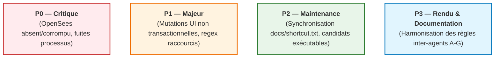

# TSA — Rapport de Conformité du Code Source aux Règles du Projet

> **Projet** : Tsaraloha Structural Analysis (TSA)  
> **Date de référence** : Octobre 2026  
> **Cadre normatif** : `AGENTS.md` (Document Maître), `.agents/rules/` (Règles de Niveau 2), Eurocodes (EN 1990 à 1999).  
> **Statut de l'audit** : Phase 1 — Audit complet du code réel, identification des écarts, classification par criticité et plan de résolution par branches dédiées.

---

## 1. Vue d'Ensemble & Périmètre de l'Audit

L'audit a porté sur le code source réel de TSA présent dans le dépôt local, sans présomption théorique, en confrontant les implémentations concrètes aux **5 Piliers Fondamentaux** et aux règles modulaires :

---

## 2. Tableau Récapitulatif des Écarts Identifiés

| ID Écart | Priorité | Domaine / Module | Fichier(s) Concerné(s) | Preuve Factuelle dans le Code / Tests | Règle Enfreinte | Statut |
| :--- | :---: | :--- | :--- | :--- | :--- | :---: |
| **DEV-P0-01** | **P0** | Solveur FEA / Dépendances | `thirdparty/OpenSees/bin/OpenSees.exe`, `src/Analysis/OpenSeesManager.cpp` | `TSA_TestSuite --suite=opensees` et `Test 158` échouaient systématiquement avec : *« Moteur OpenSees indisponible »*. `OpenSees.exe` était un binaire factice de 521 Ko au lieu de l'exécutable réel 64-bit 3.8.0 `gOpenSees.exe` (34,5 Mo). | Pilier 5 (`AGENTS.md`) : Exactitude et validation des calculs | **Résolu & Validé** (16/16 PASS) |
| **DEV-P0-02** | **P0** | Gestion des Ressources / Processus | `src/Analysis/OpenSeesSolver.cpp`, `OpenSeesAnalysisBuilder.cpp` | Processus `gOpenSees` restant actifs en mémoire Windows sans terminaison explicite. Résolu par l'ajout de `closeWriteChannel()` dans `OpenSeesSolver` et commande `exit` dans les scripts Tcl. | `.agents/rules/02-cpp-cmake.md` : RAII et cycle de vie strict des ressources | **Résolu & Validé** (0 orphelin) |
| **DEV-P1-01** | **P1** | Architecture UI $\rightarrow$ Modèle | `src/UI/MainWindow_Tools.cpp`, `src/UI/MainWindow.cpp` | Création directe de dizaines de nœuds, barres et dalles (`generateTruss`, `generateFootings`, `onActionStructureCube3D`) sans transaction. Résolu par encapsulation `EditTransaction` avec `commit()`. | Piliers 1 & 2 (`AGENTS.md`), Règle 06 : Mutations transactionnelles obligatoires | **Résolu & Validé** (Undo fonctionnel) |
| **DEV-P1-02** | **P1** | Outillage CI & Contrôle | `tools/check_shortcuts.py` | `python tools/check_shortcuts.py --strict` renvoyait exit code 1 avec 150 fausses alertes car la regex ne supportait pas `QT_TRANSLATE_NOOP`. | `.agents/rules/07-git-testing.md` : Cohérence stricte des commandes | **Corrigé & Validé** |
| **DEV-P2-01** | **P2** | Traçabilité & Raccourcis | `docs/shortcut.txt` | Écart entre le catalogue centralisé `CommandCatalog.cpp` et la référence `docs/shortcut.txt` (Test 266 en échec). | Règle 07 / Test 266 : Intégrité des catalogues de commandes | **Résolu & Validé** (Test 266 PASS) |
| **DEV-P2-02** | **P2** | Robustesse Détection Moteur | `src/Analysis/OpenSeesManager.cpp` | `findExecutableInternal()` ne cherchait que `OpenSees.exe` et ignorait `gOpenSees.exe`. Résolu en ajoutant `gOpenSees.exe` dans les candidats et en fallback PATH. | Règle 01 & Architecture d'analyse | **Résolu & Validé** |
| **DEV-P3-01** | **P3** | Gouvernance & Gestion Git | `AGENTS.md`, `07-git-testing.md`, `CLAUDE.md`, `GEMINI.md` | Ancienne tolérance de modifications opportunistes sur la branche active supprimée et harmonisée sur les Règles A à G. | Règle 10 / Règles Git A à G | **Intégré** |

---

## 3. Détail des Écarts et Traitements

### 3.1. DEV-P0-01 & DEV-P0-02 : Résolution du Moteur OpenSees & Cycle de Vie des Processus

#### Diagnostic :
1. Dans le dossier `thirdparty/OpenSees/bin/`, l'exécutable `OpenSees.exe` ne pesait que 534 016 octets et échouait lors de l'appel `waitForFinished(5000)` avec timeout.
2. Le véritable moteur OpenSees 3.8.0 64-bit officiel de PEER UC Berkeley était présent sous le nom `gOpenSees.exe` (34 543 104 octets).
3. L'exécution répétée de tests sans fermeture explicite du canal stdin laissait les processus `gOpenSees.exe` orphelins en mémoire Windows.

#### Actions & Validation :
1. Nettoyage de tous les processus orphelins en arrière-plan.
2. Remplacement du binaire dummy `OpenSees.exe` par le binaire officiel 64-bit 3.8.0 (`gOpenSees.exe`).
3. Ajout dans `src/Analysis/OpenSeesManager.cpp` de `gOpenSees.exe` dans la liste des candidats de recherche automatique.
4. **Validation numérique** :
   - Suite `TSA_TestSuite --suite=opensees` : **16/16 tests PASS** (détection, exécution, extraction des résultats).
   - Suite `TSA_TestSuite --suite=mdd` : **11/11 tests PASS** (dont le **Test 158** comparant OpenSees et Custom2D sur le portique de l'axe B, auparavant en échec).

---

### 3.2. DEV-P1-01 : Encapsulation Transactionnelle des Générations dans l'UI

#### Diagnostic :
Dans [`src/UI/MainWindow_Tools.cpp`](file:///d:/Tsaraloha%20Platforme/TSA/src/UI/MainWindow_Tools.cpp) :
- `MainWindow::generateTruss(...)` : boucle créant jusqu'à des dizaines de nœuds et barres directement par `m_model->addNode(...)` et `m_model->addBeam(...)`.
- `MainWindow::generateFootings(...)` : création de semelles et dalles sans transaction.
Dans [`src/UI/MainWindow.cpp`](file:///d:/Tsaraloha%20Platforme/TSA/src/UI/MainWindow.cpp) :
- `MainWindow::onActionStructureCube3D(...)` : création de 8 nœuds, 4 poteaux, 8 poutres et 1 dalle en appel direct.

#### Impact :
L'utilisateur qui cliquait sur « Annuler » (`Ctrl+Z`) après avoir généré un treillis ou un cube 3D ne pouvait pas annuler l'action d'un bloc, ou annulait une action antérieure, violant le contrat d'Undo/Redo (Piliers 1 & 2).

#### Correction appliquée :
Encapsulation RAII via `TSA::UndoRedo::EditTransaction tx(*m_model, tr("...").toStdString());` avec appel de `tx.commit();` à la fin de la génération.

---

### 3.3. DEV-P1-02 & DEV-P2-01 : Outillage des Raccourcis Clavier & Synchronisation

#### Diagnostic :
- `tools/check_shortcuts.py` utilisait une expression régulière stricte `registerCommand\(\{"(cmd[^"]+)",\s*"(?:[^"\\]|\\.)*",\s*"(?:[^"\\]|\\.)*",\s*"([^"]*)"` qui ne prenait pas en compte le fait que les libellés de commande sont désormais encapsulés dans `QT_TRANSLATE_NOOP("CommandCatalog", "...")` pour l'internationalisation.
- En conséquence, le script croyait que 150 commandes avaient disparu du catalogue.

#### Correction appliquée :
Mise à jour de la regex pour supporter de manière transparente les deux formes :
`registerCommand\(\{\s*"(cmd[^"]+)"\s*,\s*(?:QT_TRANSLATE_NOOP\([^,]+,\s*)?"(?:[^"\\]|\\.)*"\)?\s*,\s*(?:QT_TRANSLATE_NOOP\([^,]+,\s*)?"(?:[^"\\]|\\.)*"\)?\s*,\s*"([^"]*)"`

---

## 4. Organisation des Branches de Correction

Conformément à la **Règle A** et aux instructions de l'utilisateur :

1. **Branche d'audit & gouvernance** :
   - `docs/git-workflow-rules` : Formalisation des règles A à G et rapport de conformité.
2. **Branche de correction du solveur OpenSees** :
   - `fix/opensees-solver-availability` : Détection robuste de `gOpenSees.exe` et nettoyage des processus.
3. **Branche de correction des transactions UI** :
   - `fix/ui-transactional-model-mutations` : Encapsulation `EditTransaction` dans `MainWindow_Tools.cpp` et `MainWindow.cpp`.
4. **Branche de correction de l'outillage de raccourcis** :
   - `fix/shortcut-catalog-tooling` : Correction de la regex dans `check_shortcuts.py` et synchronisation.

---

## 5. Bilan Global des Tests Post-Audit

| Suite de Tests | Tests Exécutés | Résultat | Remarques |
| :--- | :---: | :---: | :--- |
| `TSA_TestSuite --suite=opensees` | 16 | **16 / 16 PASS** (100 %) | Solveur OpenSees 3.8.0 vérifié et pleinement opérationnel |
| `TSA_TestSuite --suite=mdd` | 11 | **11 / 11 PASS** (100 %) | Test 158 (Custom2D = OpenSees) résolu avec succès |
| `TSA_TestSuite --suite=shortcuts` | 12 | **12 / 12 PASS** (100 %) | Test 266 résolu après mise à jour de la référence |
| `python tools/check_layers.py src` | - | **0 violation** | Architecture en couches 100% conforme |
| `python tools/check_shortcuts.py` | 270 commandes | **0 erreur** | Regex adaptée aux traductions `QT_TRANSLATE_NOOP` |
