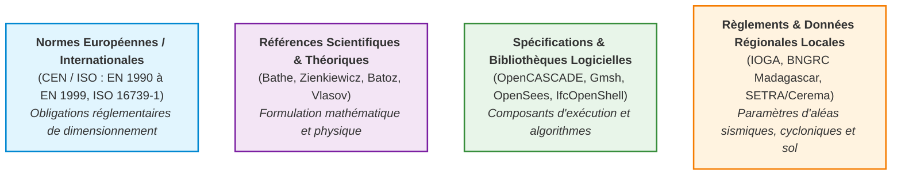
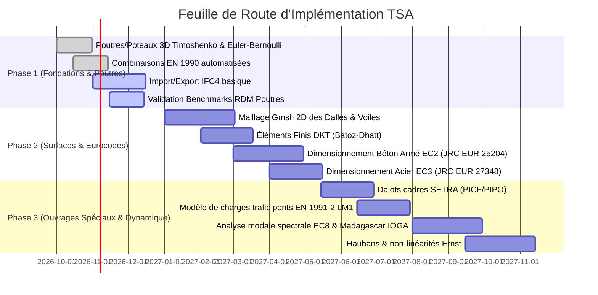

# TSA — Priorités d'Implémentation & Feuille de Route Technique

> Ce document établit la feuille de route technique et méthodologique pour l'implémentation et l'enrichissement des modules de **Tsaraloha Structural Analysis (TSA)**. Il relie chaque sous-système architectural du logiciel aux références documentaires, scientifiques, normatives et logicielles correspondantes, répertoriées dans le [Catalogue Général des Références](file:///d:/Tsaraloha%20Platforme/TSA/docs/references/CATALOGUE_REFERENCES.md).

---

## 1. Classification & Distinction Épistémologique des Références

Conformément aux exigences de rigueur de TSA, les références sont classées en quatre catégories distinctes qui ne doivent jamais être confondues :

> [!CAUTION]
> **Règle fondamentale** : Une publication théorique (ex. thèse ou article universitaire de MEF) explique la physique et l'intégration numérique, mais n'a **aucune force réglementaire**. Inversement, une norme (Eurocode) fixe des critères de sécurité ($\gamma_M$, flèches admissibles, combinaisons), mais ne dicte pas l'implémentation de la matrice de rigidité interne du solveur.

---

## 2. Matrice d'Alignement par Sous-Système TSA

### 2.1. Modélisation BIM & Interopérabilité

| Module TSA | Responsabilité Métier | Références Clés | Type de Référence |
| :--- | :--- | :--- | :--- |
| `src/BIM/IfcImporter.cpp` | Lecture et désérialisation STEP ISO 10303-21 | [REF-BIM-01](file:///d:/Tsaraloha%20Platforme/TSA/docs/references/CATALOGUE_REFERENCES.md#ref-bim-01) (IFC 4.3), [REF-BIM-02](file:///d:/Tsaraloha%20Platforme/TSA/docs/references/CATALOGUE_REFERENCES.md#ref-bim-02) (IFC4) | Norme Internationale (ISO 16739-1) |
| `src/BIM/IfcExporter.cpp` | Génération de maquette numérique conforme | [REF-BIM-03](file:///d:/Tsaraloha%20Platforme/TSA/docs/references/CATALOGUE_REFERENCES.md#ref-bim-03) (Structural Analysis Domain) | Spécification buildingSMART |
| `src/BIM/BimMapping.cpp` | Correspondance `Element` ↔ `IfcProduct` | [REF-BIM-04](file:///d:/Tsaraloha%20Platforme/TSA/docs/references/CATALOGUE_REFERENCES.md#ref-bim-04) (IDS v1.0) | Standard ouvert de contrôle |
| Validation / Non-régression | Banc de tests d'importation géométrique | [REF-BIM-05](file:///d:/Tsaraloha%20Platforme/TSA/docs/references/CATALOGUE_REFERENCES.md#ref-bim-05) (11 modèles officiels buildingSMART) | Banc d'essais open-source |

#### Directives d'implémentation :
1. **Poutres et Poteaux** : Exporter sous forme de solides d'extrusion `IfcExtrudedAreaSolid` avec profil standardisé `IfcProfileDef` (`IfcIShapeProfileDef`, `IfcRectangleProfileDef`) et géométrie axiale associée dans le domaine analytique (`IfcStructuralCurveMember`).
2. **Dalles et Voiles** : Assurer l'affectation spatiale (`IfcRelContainedInSpatialStructure`) au niveau d'étage correspondant (`IfcBuildingStorey`).
3. **Contrôle IDS** : Vérifier que chaque entité exportée possède les `Pset_BeamCommon`, `Pset_ColumnCommon` ou `Pset_SlabCommon` avec les propriétés structurales minimales (`LoadBearing = TRUE`, matériau, classe de résistance).

---

### 2.2. Création, Modification Géométrique & Rendu 3D

| Module TSA | Responsabilité Métier | Références Clés | Type de Référence |
| :--- | :--- | :--- | :--- |
| `src/Geometry/*Geometry.cpp` | Construction B-Rep solide exacte des profilés et parois | [REF-LIB-01](file:///d:/Tsaraloha%20Platforme/TSA/docs/references/CATALOGUE_REFERENCES.md#ref-lib-01) (OCCT 8.0.1 BRepPrimAPI, BRepAlgoAPI) | Spécification Logicielle (LGPL 2.1) |
| `src/Geometry/SectionGeometry.cpp` | Paramétrage 2D des contours de sections (IPE, HEB, RHS...) | [REF-EC-03](file:///d:/Tsaraloha%20Platforme/TSA/docs/references/CATALOGUE_REFERENCES.md#ref-ec-03) & [docs/SECTIONS.md](file:///d:/Tsaraloha%20Platforme/TSA/docs/SECTIONS.md) | Normatif / Catalogues standards |
| `src/Viewer/OccView.cpp` | Visualisation 3D interactive, sélection et gizmo | [REF-LIB-01](file:///d:/Tsaraloha%20Platforme/TSA/docs/references/CATALOGUE_REFERENCES.md#ref-lib-01) (AIS_InteractiveContext, V3d_View) | Composant d'exécution |

#### Directives d'implémentation :
1. **Extrusion vectorielle orientée** : Utiliser `BRepPrimAPI_MakePrism` pour les éléments linéaires le long de l'axe directeur $\vec{L} = N_2 - N_1$, avec rotation selon l'angle de section `rotationAngleDeg`.
2. **Réservation et Ouvertures** : Implémenter les trémies dans les dalles (`Slab`) et baies dans les voiles (`Wall`) via `BRepAlgoAPI_Cut` robuste en vérifiant la validité topologique (`BRepCheck_Analyzer`).
3. **Séparation Stricte** : La forme topologique `TopoDS_Shape` est une projection éphémère du modèle ; toute modification de dimension doit impérativement modifier l'attribut dans `TSA::Model::Element`, puis notifier `IModelObserver`.

---

### 2.3. Maillage Éléments Finis

| Module TSA | Responsabilité Métier | Références Clés | Type de Référence |
| :--- | :--- | :--- | :--- |
| `src/Mesh/Gmsh/GmshWrapper.cpp` | Interface C++ avec l'API Gmsh SDK | [REF-LIB-02](file:///d:/Tsaraloha%20Platforme/TSA/docs/references/CATALOGUE_REFERENCES.md#ref-lib-02) (Gmsh 4.15 Reference Manual) | Bibliothèque Logicielle (GPLv2+) |
| `src/Mesh/MeshGenerator.cpp` | Pilotage de la discrétisation 1D (barres) et 2D (plaques) | [REF-FEM-01](file:///d:/Tsaraloha%20Platforme/TSA/docs/references/CATALOGUE_REFERENCES.md#ref-fem-01) (Bathe) & [REF-FEM-03](file:///d:/Tsaraloha%20Platforme/TSA/docs/references/CATALOGUE_REFERENCES.md#ref-fem-03) (Batoz-Dhatt) | Scientifique / Algorithmique |
| `src/Mesh/MeshQuality.cpp` | Vérification de la régularité des mailles | [REF-LIB-02](file:///d:/Tsaraloha%20Platforme/TSA/docs/references/CATALOGUE_REFERENCES.md#ref-lib-02) (Critères SICN, Gamma, Aspect Ratio) | Qualité numérique |

#### Directives d'implémentation :
1. **Algorithme de surface 2D** : Utiliser l'algorithme Frontal-Delaunay (`Mesh.Algorithm = 6`) pour obtenir des triangles réguliers sans distorsion excessive autour des poteaux et ouvertures.
2. **Points d'accrochage nodaux** : Forcer la présence de nœuds conformes aux intersections poteau-dalle (`gmsh::model::mesh::embed`) pour garantir la transmission correcte des efforts tranchants et moments.
3. **Contrôle de conformité** : Émettre un avertissement si le ratio d'aspect dépasse $1:4$ ou si le facteur SICN (Signed Inverted Condition Number) est inférieur à 0.3.

---

### 2.4. Théorie Éléments Finis & Solveurs

| Module TSA | Responsabilité Métier | Références Clés | Type de Référence |
| :--- | :--- | :--- | :--- |
| `src/Analysis/OpenSeesEngine.cpp` | Génération de scripts Tcl et exécution du processus OpenSees | [REF-FEM-05](file:///d:/Tsaraloha%20Platforme/TSA/docs/references/CATALOGUE_REFERENCES.md#ref-fem-05) (OpenSees Command Language Manual) | Solveur Externe Open Source |
| `tsalab_science` (Dépôt frère) | Solveur 2D direct RDM (méthode des déplacements) | [REF-FEM-01](file:///d:/Tsaraloha%20Platforme/TSA/docs/references/CATALOGUE_REFERENCES.md#ref-fem-01) (Bathe) | Formulation Analytique / MEF |
| Éléments Poutres 3D | Poutre Euler-Bernoulli & Timoshenko (flexion + cisaillement) | [REF-FEM-01](file:///d:/Tsaraloha%20Platforme/TSA/docs/references/CATALOGUE_REFERENCES.md#ref-fem-01) & [docs/references/FEM_Theory/](file:///d:/Tsaraloha%20Platforme/TSA/docs/references/FEM_Theory/) | Théorie RDM exacte |
| Éléments de Plaque | Flexion de plaque mince (DKT) et coque membranaire | [REF-FEM-03](file:///d:/Tsaraloha%20Platforme/TSA/docs/references/CATALOGUE_REFERENCES.md#ref-fem-03) (Batoz & Dhatt) & [REF-FEM-02](file:///d:/Tsaraloha%20Platforme/TSA/docs/references/CATALOGUE_REFERENCES.md#ref-fem-02) (Zienkiewicz) | Théorie MEF Plaques |
| Torsion Spécialisée | Torsion non-uniforme avec gauchissement (7 DDL/nœud) | [REF-FEM-04](file:///d:/Tsaraloha%20Platforme/TSA/docs/references/CATALOGUE_REFERENCES.md#ref-fem-04) (Vlasov) | Théorie Analytique Barres Minces |

#### Directives d'implémentation :
1. **Élément poutre par défaut** : Utiliser l'élément Timoshenko 3D avec facteurs de cisaillement $k_y, k_z$ pour intégrer la déformabilité d'effort tranchant sur les éléments courts ou de forte inertie.
2. **Câbles et Haubans** : Intégrer la non-linéarité géométrique avec le module sécant d'Ernst $E_{eq} = \frac{E}{1 + \frac{(\gamma L)^2 E}{12 \sigma^3}}$ ([REF-BRG-03](file:///d:/Tsaraloha%20Platforme/TSA/docs/references/Bridges_Infrastructure/REFERENCE_GUIDE.md)).
3. **Matrices de passage 3D** : Conserver la convention orthonormée avec vecteur de référence vertical $\vec{v}_{ref} = (0, 0, 1)$ pour la construction robuste du repère local $(\vec{x}_l, \vec{y}_l, \vec{z}_l)$.

---

### 2.5. Combinaisons d'Actions & Chargements

| Module TSA | Responsabilité Métier | Références Clés | Type de Référence |
| :--- | :--- | :--- | :--- |
| `src/Model/Load/LoadCombination.h` | Moteur combinatoire automatisé ELU / ELS | [REF-EC-00](file:///d:/Tsaraloha%20Platforme/TSA/docs/references/CATALOGUE_REFERENCES.md#ref-ec-00) (EN 1990:2002 + A1:2005) | Norme Européenne Obligatoire |
| `src/Model/Load/LoadManager.h` | Gestion des cas de charges (G, Q, W, S, E, T) | [REF-EC-01](file:///d:/Tsaraloha%20Platforme/TSA/docs/references/CATALOGUE_REFERENCES.md#ref-ec-01) (EN 1991 Poutres & Bâtiments) | Norme Européenne |
| Charges de Trafic Routier | Modèles de charges de ponts (LM1, LM2) | [REF-BRG-01](file:///d:/Tsaraloha%20Platforme/TSA/docs/references/CATALOGUE_REFERENCES.md#ref-brg-01) (EN 1991-2 & JRC EUR 25193) | Norme & Guide d'application |
| Actions Régionales (Madagascar) | Pressions de vent cyclonique et zonage sismique | [REF-MAD-01](file:///d:/Tsaraloha%20Platforme/TSA/docs/references/CATALOGUE_REFERENCES.md#ref-mad-01) (IOGA) & [REF-MAD-02](file:///d:/Tsaraloha%20Platforme/TSA/docs/references/CATALOGUE_REFERENCES.md#ref-mad-02) (BNGRC) | Réglementation & Données Locales |

#### Formulations normatives à implémenter :
- **Combinaison Fondamentale ELU (STR/GEO)** :
  $$\sum_{j \ge 1} \gamma_{G,j} G_{k,j} + \gamma_P P + \gamma_{Q,1} Q_{k,1} + \sum_{i > 1} \gamma_{Q,i} \psi_{0,i} Q_{k,i}$$
  *Valeurs standard EN 1990* : $\gamma_{G} = 1.35$ (défavorable) / $1.00$ (favorable), $\gamma_{Q} = 1.50$ (défavorable) / $0.00$.
- **Combinaisons ELS** :
  - Caractéristique : $\sum G_{k,j} + Q_{k,1} + \sum_{i > 1} \psi_{0,i} Q_{k,i}$
  - Fréquente : $\sum G_{k,j} + \psi_{1,1} Q_{k,1} + \sum_{i > 1} \psi_{2,i} Q_{k,i}$
  - Quasi-permanente : $\sum G_{k,j} + \sum_{i \ge 1} \psi_{2,i} Q_{k,i}$

---

### 2.6. Notes de Calcul & Justification Normative

| Module TSA | Responsabilité Métier | Références Clés | Type de Référence |
| :--- | :--- | :--- | :--- |
| `src/NDC/ReportGenerator.cpp` | Génération de notes de calculs structurées et transparentes | [REF-EC-02](file:///d:/Tsaraloha%20Platforme/TSA/docs/references/CATALOGUE_REFERENCES.md#ref-ec-02) (EC2) & [REF-EC-03](file:///d:/Tsaraloha%20Platforme/TSA/docs/references/CATALOGUE_REFERENCES.md#ref-ec-03) (EC3) | Normes de Dimensionnement |
| Vérification Béton Armé | Armatures longitudinales, cadres d'effort tranchant, flèches | [REF-EC-02](file:///d:/Tsaraloha%20Platforme/TSA/docs/references/CATALOGUE_REFERENCES.md#ref-ec-02) (JRC EUR 25204) | Guide Officiel de Calcul |
| Vérification Acier | Ratios de travail, flambement avec courbes $a, b, c, d$, déversement | [REF-EC-03](file:///d:/Tsaraloha%20Platforme/TSA/docs/references/CATALOGUE_REFERENCES.md#ref-ec-03) (JRC EUR 27348) | Guide Officiel de Calcul |
| Vérification Fondations | Tassements admissibles et portance sous semelle | [REF-EC-07](file:///d:/Tsaraloha%20Platforme/TSA/docs/references/CATALOGUE_REFERENCES.md#ref-ec-07) (EN 1997-1) | Norme Géotechnique |

#### Directives de génération de NDC :
- **Traçabilité totale** : Chaque vérification doit afficher la formule analytique complète, les valeurs numériques injectées, la référence exacte de l'article de la norme (ex. `EN 1992-1-1 §6.2.2 Eq. (6.2a)`), la valeur limite et le ratio d'exploitation $\eta = \frac{E_d}{R_d} \le 1.00$.

---

### 2.7. Ouvrages Spéciaux : Ponts, Dalots & Murs de Soutènement

| Typologie d'Ouvrage | Comportement Physique & Modélisation | Références Clés | Type de Référence |
| :--- | :--- | :--- | :--- |
| **Ponts à poutres / VIPP** | Flexion globale des poutres maîtresses, torsion de torsion d'entretoisement | [REF-BRG-01](file:///d:/Tsaraloha%20Platforme/TSA/docs/references/CATALOGUE_REFERENCES.md#ref-brg-01) & [REF-BRG-02](file:///d:/Tsaraloha%20Platforme/TSA/docs/references/CATALOGUE_REFERENCES.md#ref-brg-02) (SETRA) | Guide Technique Officiel |
| **Dalots Cadres (PICF / PIPO)** | Portique fermé enterré sous poussée des terres et essieux lourds | [REF-HYD-01](file:///d:/Tsaraloha%20Platforme/TSA/docs/references/CATALOGUE_REFERENCES.md#ref-hyd-01) (SETRA / Cerema) | Guide Technique d'État |
| **Murs de Soutènement** | Équilibre limite de Rankine/Coulomb, stabilité d'ensemble | [REF-GEO-01](file:///d:/Tsaraloha%20Platforme/TSA/docs/references/CATALOGUE_REFERENCES.md#ref-geo-01) (Cerema) & [REF-EC-07](file:///d:/Tsaraloha%20Platforme/TSA/docs/references/CATALOGUE_REFERENCES.md#ref-ec-07) | Recommandations Nationales |

---

## 3. Feuille de Route en 3 Phases Temporelles

### Phase 1 : Consolidation du Cœur Éléments Finis Linéaire & IFC Bâtiment
- Intégration systématique des matrices de Timoshenko 3D ($12 \times 12$).
- Validation des 11 modèles de tests buildingSMART (`tests/data/ifc/buildingsmart/`).
- Moteur de combinaisons complètes d'après l'EN 1990 Eq. 6.10.

### Phase 2 : Éléments Surfaciques (Dalles/Voiles) & Vérifications Eurocodes
- Discrétisation Gmsh des surfaces planes avec préservation des nœuds poteaux.
- Solveur plaques DKT pour dalles en flexion.
- Modules de vérification des sections selon l'EC2 (béton) et l'EC3 (acier).
- Sortie de la Note de Calcul (NDC) avec rendu transparent des formules.

### Phase 3 : Ouvrages de Génie Civil & Dynamique
- Générateur d'ouvrages hydrauliques types (dalots cadres SETRA).
- Déploiement des convois routiers réglementaires (Eurocode 1-2 LM1).
- Analyse sismique modale spectrale intégrant le zonage IOGA de Madagascar.
